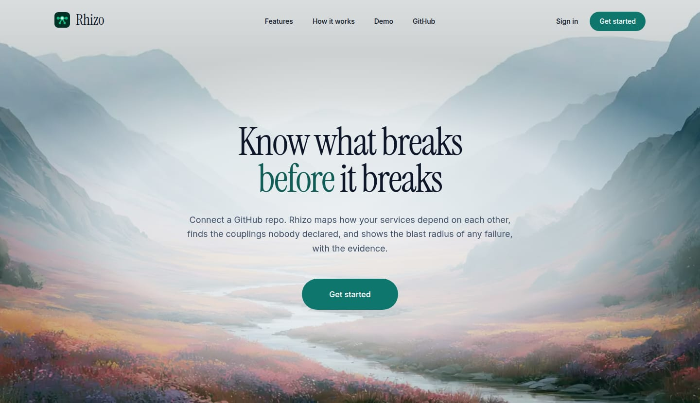
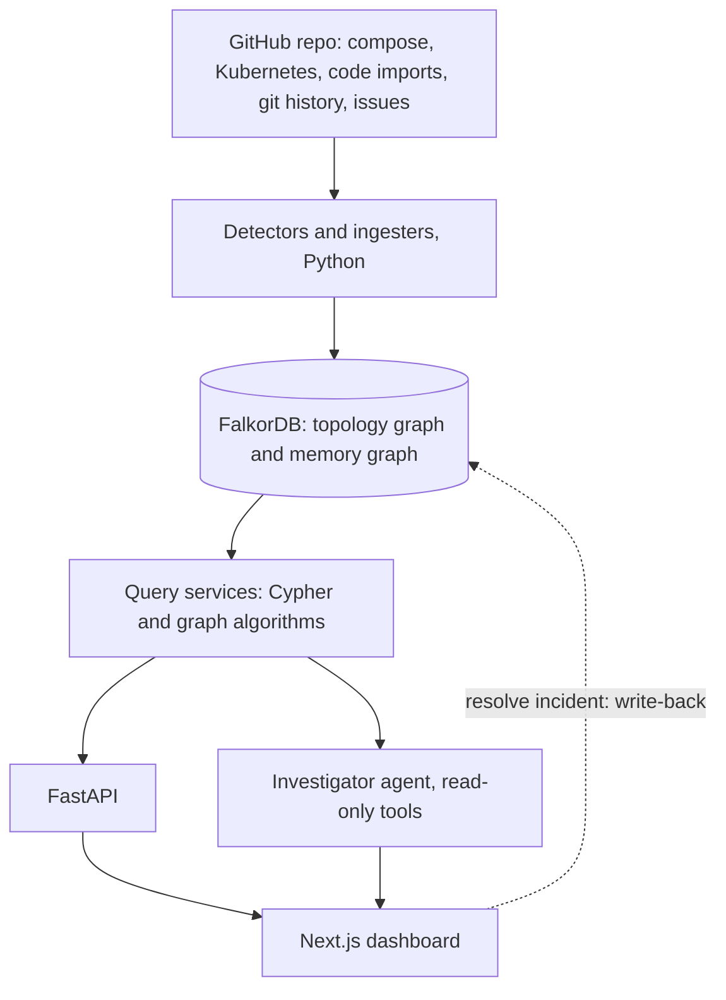

<p align="center">
  
</p>

<h1 align="center">Rhizo</h1>

<h3 align="center">Know what breaks before it breaks.</h3>

<p align="center">
  Connect a GitHub repo. Rhizo maps how its services depend on each other, finds the couplings nobody declared,<br/>
  and shows the blast radius of any failure, with the evidence.
</p>

<p align="center">
  
  
  
  
  
</p>

<p align="center">
  
</p>

---

## The problem

When a service fails, someone has to answer three questions fast: **what else breaks, who knows this system, and has this happened before?** In most teams that knowledge lives in a few senior engineers' heads. Declared dependencies are incomplete, and the riskiest couplings, such as shared databases or files that always change together, are the ones nobody wrote down.

## What Rhizo does

Rhizo reads a public GitHub repository, builds a dependency graph in **FalkorDB**, and answers graph questions about it. Every answer shows the path and the Cypher query behind it, so nothing is a black box.

| | Feature | What you get |
|---|---|---|
| 🔌 | **Connect any public repo** | Services detected from docker-compose, Kubernetes manifests and Python/JS/TS import graphs. Nothing in the repo is ever executed. |
| 💥 | **Blast radius** | Which services break if a service or resource fails, how many hops away, and how confident each path is. |
| 👻 | **Hidden dependencies** | Coupling nobody declared, found from shared resources and from git co-change. |
| 🔍 | **Change check** | Risk score for a diff, with the coupled files and the engineers who know that code. |
| 📈 | **Rankings** | The most critical services by PageRank, betweenness and community structure. |
| 🧠 | **Incident memory** | Report and resolve incidents. Confirming or refuting a root cause updates the graph, so it improves with use. |
| 💬 | **Investigator** | Ask in plain language. It reads the graph through read-only tools and cites the path and query for every claim. |
| 🧪 | **Benchmark** | A held-out evaluation per repo: do hidden dependencies predict future co-changes better than declared edges alone? |

## Tested on real repositories

Numbers from syncs during development; they are reproducible by connecting the same repos.

| Repository | What Rhizo found |
|---|---|
| `GoogleCloudPlatform/microservices-demo` | 13 services, 17 declared dependencies, 3 hidden co-change dependencies, 9 incidents from fix commits (3,000-commit history) |
| `changesets/changesets` | 24 packages, 68 dependencies from code imports, 15 incidents from fix commits |
| `pallets/flask` | 2 packages, 2 dependencies from code imports |

## Architecture



Each connected repo gets its own pair of graphs, `r_<user>_<repo>` for topology and `r_<user>_<repo>_memory` for incidents, scoped to the signed-in user. FalkorDB is not optional: stop it and the API returns `503`, because blast radius, hidden dependencies and incident memory are all graph queries.

**How a sync works:** clone safely (partial, read-only, hooks and symlinks disabled) → detect services and dependencies → import git history (authors pseudonymised, no emails stored) → mine co-change → rank tiers by PageRank → derive incidents from closed bug issues and fix commits → run the held-out benchmark.

**Stack:** FalkorDB, Python 3.12 and FastAPI, Next.js 16 and TanStack Query, Docker Compose.

## Run it locally

**Requirements:** Docker with Compose, Node.js 20.9 or newer, and git.

```bash
git clone https://github.com/sanikaap/Rhizo.git
cd Rhizo

# 1. Configuration
cp backend/.env.example backend/.env
cp frontend/.env.example frontend/.env.local

# 2. Generate one secret and put the SAME value in both files as AUTH_SECRET
openssl rand -base64 48
#   backend/.env          -> AUTH_SECRET=<value>
#   frontend/.env.local   -> AUTH_SECRET=<value>

# 3. Start FalkorDB and the API
docker compose up -d --build
docker compose ps                      # falkordb and api should be running

# 4. Start the frontend
cd frontend
npm install
npm run dev
```

Open **http://localhost:5173**, sign up with an email and password (no verification step), and wait for the built-in demo repo to reach **ready**.

| Service | URL |
|---|---|
| Dashboard | http://localhost:5173 |
| API and interactive docs | http://localhost:8000/docs |
| FalkorDB Browser (inspect the graph) | http://localhost:3000 |

### Configuration

| Variable | File | Purpose |
|---|---|---|
| `AUTH_SECRET` | backend and frontend | Signs and verifies login tokens. At least 32 characters, identical in both files. |
| `GITHUB_TOKEN` | backend | Optional. A token with **no scopes** raises GitHub's rate limit for public repos. |
| `AGENT_MODE` | backend | `scripted` (default, no API key needed) or `llm`. |
| `ANTHROPIC_API_KEY`, `LLM_MODEL` | backend | Only for `llm` mode. |
| `GIT_MAX_COMMITS` | backend | History read per sync, 3000 by default. |
| `NEXT_PUBLIC_API_BASE_URL` | frontend | API address, `http://localhost:8000` by default. |
| `FALKORDB_HOST_PORT` | root `.env` | Host port for FalkorDB. Set `6380` if your machine already uses `6379`. |

All variables are listed in the `.env.example` files. Never commit real values.

### Try it

1. The demo repo, Google's [Online Boutique](https://github.com/GoogleCloudPlatform/microservices-demo), is created automatically on first login. If a local copy exists in `data/demo` it is read from there; otherwise it is cloned like any other repo.
2. Open **Graph**, select a service, and run **Simulate failure**.
3. On the **Overview**, look at **Hidden dependencies** and **Most critical services**.
4. Go to **Repositories**, paste any public GitHub URL, and watch it sync live.
5. Report an incident, resolve it, and watch the confirmed edge strengthen in the graph.
6. Open **Benchmark** to see the held-out evaluation for the selected repo.
7. Remove the demo from **Repositories** at any time, and bring it back with **Load demo repo**.

### Tests and checks

```bash
cd backend && pip install -e ".[dev]" && pytest && ruff check . && mypy rhizo
cd frontend && npm test && npx tsc --noEmit
```

### Troubleshooting

| Symptom | Fix |
|---|---|
| Every request returns `401` | `AUTH_SECRET` differs between the two files. Make them identical and restart both. |
| `port is already allocated` | Change `FALKORDB_HOST_PORT` in the root `.env`. |
| Repo sync fails with a rate-limit error | Add `GITHUB_TOKEN` to `backend/.env`, then `docker compose restart api`. |
| Changes to `backend/.env` do nothing | Run `docker compose up -d --build`. |

## Graph data model

**Topology graph** (`r_<user>_<repo>`)

| Node | Key properties |
|---|---|
| `Service` | `name`, `tier` and `tier_basis` (from PageRank), `language`, `path_prefix`, `detected_by`, `repo` |
| `Resource` | `name`, `kind` (database, cache, queue) |
| `Commit` | `sha`, `ts`, `message`, `files_count`, `bot` |
| `File` | `path` |
| `Engineer` | `handle`, `name` (pseudonymised by default, no emails stored) |

| Relationship | Meaning | Properties |
|---|---|---|
| `(Service)-[:DEPENDS_ON]->(Service)` | A is hurt when B fails | `source`, `confidence`, `evidence`, `valid_from`, `valid_to`, `last_seen` |
| `(Service)-[:USES]->(Resource)` | A needs the resource | same as above |
| `(Service)-[:CO_CHANGES_WITH]->(Service)` | Changed together in git history (stored once per pair) | `support`, `jaccard`, `confidence`, `evidence`, `valid_from`, `valid_to` |
| `(Commit)-[:TOUCHED]->(File)-[:PART_OF]->(Service)` | Which commit changed which service | |
| `(Engineer)-[:AUTHORED]->(Commit)`, `(Engineer)-[:COMMITTED_TO]->(Service)` | Who works on what | `count`, `last_at` |

**Memory graph** (`r_<user>_<repo>_memory`)

| Node or relationship | Meaning |
|---|---|
| `Incident` | `id`, `title`, `symptom`, `severity`, `status`, `started_at`, `resolved_at`, `fix`, `source`, `url` |
| `(Incident)-[:AFFECTED]->(Service)` | Where the symptom showed |
| `(Incident)-[:ROOT_CAUSE]->(Service or Resource)` | Confirmed root cause |
| `(Incident)-[:RESOLVED_BY]->(Engineer)` | Who resolved it |
| `(Incident)-[:REVEALED]->(Service)` | Dependencies the incident confirmed |

`DEPENDS_ON` direction is the key convention: `A -> B` means **A is the victim when B fails**, so blast radius follows paths *into* the failing node. Edges carry provenance (`source`: declared, code, observed or inferred, plus `evidence`) and a validity range, so the graph can be queried as of a past date and stale edges expire instead of lingering.

## Key Cypher queries

All queries live in [`backend/rhizo/graph/queries.py`](backend/rhizo/graph/queries.py). Values are always parameters; only validated integers are formatted into hop bounds. Shown with the API's default depth of 4.

**Blast radius of a service.** Every service with a live, confident path into the failing one. Path confidence is the product of edge confidences, and `$as_of` enables time travel.

```cypher
MATCH p = (v:Service)-[:DEPENDS_ON*1..4]->(s:Service)
WHERE s.name IN $names AND NOT v.name IN $failed
  AND all(x IN relationships(p) WHERE
        (($as_of IS NULL AND x.valid_to IS NULL) OR
         ($as_of IS NOT NULL AND x.valid_from <= $as_of AND (x.valid_to IS NULL OR x.valid_to > $as_of)))
        AND x.confidence >= $min_conf)
RETURN v.name AS victim, [n IN nodes(p) | n.name] AS path,
       [x IN relationships(p) | x.source] AS sources,
       reduce(c = 1.0, x IN relationships(p) | c * x.confidence) AS path_conf
```

**Blast radius of a resource.** The last hop is `USES`, then `DEPENDS_ON` back toward the victims.

```cypher
MATCH p = (v:Service)-[:DEPENDS_ON*0..3]->(:Service)-[:USES]->(r:Resource)
WHERE r.name IN $names AND NOT v.name IN $failed
  AND all(x IN relationships(p) WHERE <same live and confidence filter as above>)
RETURN v.name AS victim, [n IN nodes(p) | n.name] AS path,
       [x IN relationships(p) | x.source] AS sources,
       reduce(c = 1.0, x IN relationships(p) | c * x.confidence) AS path_conf
```

**Hidden dependency through a shared resource.** Two services use the same resource with no live declared path in *either* direction. Checking both directions matters: a one-sided check reports known dependencies as hidden.

```cypher
MATCH (a:Service)-[ua:USES]->(r:Resource)<-[ub:USES]-(b:Service)
WHERE a.name < b.name AND ua.valid_to IS NULL AND ub.valid_to IS NULL
  AND ($name IS NULL OR a.name = $name OR b.name = $name)
WITH DISTINCT a, b, r
OPTIONAL MATCH fwd = (a)-[:DEPENDS_ON*1..4]->(b)
WHERE all(x IN relationships(fwd) WHERE x.valid_to IS NULL)
WITH a, b, r, count(fwd) AS n_fwd
OPTIONAL MATCH back = (b)-[:DEPENDS_ON*1..4]->(a)
WHERE all(x IN relationships(back) WHERE x.valid_to IS NULL)
WITH a, b, r, n_fwd, count(back) AS n_back
WHERE n_fwd = 0 AND n_back = 0
RETURN a.name, b.name, r.name, r.kind
```

**Hidden dependency through co-change.** Pairs mined from git history (support of at least 3 commits, Jaccard of at least 0.25, ignoring bot, bulk and cross-cutting commits), minus every pair a declared path already explains.

```cypher
MATCH (a:Service)-[c:CO_CHANGES_WITH]->(b:Service)
WHERE c.valid_to IS NULL AND c.confidence >= $min_conf
  AND ($name IS NULL OR a.name = $name OR b.name = $name)
WITH a, b, c
OPTIONAL MATCH fwd = (a)-[:DEPENDS_ON*1..4]->(b)
WHERE all(x IN relationships(fwd) WHERE x.valid_to IS NULL)
WITH a, b, c, count(fwd) AS n_fwd
OPTIONAL MATCH back = (b)-[:DEPENDS_ON*1..4]->(a)
WHERE all(x IN relationships(back) WHERE x.valid_to IS NULL)
WITH a, b, c, n_fwd, count(back) AS n_back
WHERE n_fwd = 0 AND n_back = 0
RETURN a.name, b.name, c.support, c.jaccard, c.confidence
```

**Write-back on incident resolution.** A confirmed edge is created (inferred, confidence 0.60) or strengthened by 0.15; a refuted edge is weakened by 0.20, down to a floor of 0.05.

```cypher
UNWIND $rows AS row
MATCH (a:Service {name: row.from}), (b:Service {name: row.to})
MERGE (a)-[r:DEPENDS_ON]->(b)
ON CREATE SET r.source = 'inferred', r.confidence = $created_conf, r.valid_from = $now,
              r.incident_id = $incident_id, r.evidence = 'Revealed by ' + $incident_id
ON MATCH SET r.confidence = CASE WHEN r.confidence + $step > 1.0 THEN 1.0 ELSE r.confidence + $step END,
             r.incident_id = $incident_id,
             r.valid_from = CASE WHEN r.valid_to IS NULL THEN r.valid_from ELSE $now END
SET r.valid_to = null, r.last_seen = $now
RETURN count(r)
```

```cypher
UNWIND $rows AS row
MATCH (:Service {name: row.from})-[r:DEPENDS_ON]->(:Service {name: row.to})
SET r.confidence = CASE WHEN r.confidence - $step < $floor THEN $floor ELSE r.confidence - $step END
RETURN count(r)
```

Critical-service rankings use FalkorDB's PageRank (`algo.pageRank`) where available and fall back to degree counts, and the API reports which algorithm ran.

## How accuracy is kept honest

- **Every edge shows its evidence.** Path confidence is the product of edge confidences, and each edge carries its source (declared 0.95, code 0.85, inferred from co-change) and the file or commits it came from.
- **The Investigator cannot invent.** Queries produce the facts and the agent can only read the graph. In `llm` mode the model phrases tool results, and a grounding check removes any service name that did not come from them.
- **The benchmark cannot be tuned by hand.** It hides the most recent 20% of commits, mines hidden dependencies from the rest, and measures precision and recall on the co-changes that happened later, against a declared-edges-only baseline. Results are written by the run, and a repo with too little history shows "insufficient history" instead of numbers.
- **Private data stays out.** Public repositories only, git authors pseudonymised, emails never stored.

## Limitations

- Public GitHub repositories only.
- Detection covers docker-compose, Kubernetes manifests, and Python and JS/TS imports. A repo with none of these shows "no structure detected".
- History is capped per sync (3,000 commits by default). Repos with little history give weak co-change signals and benchmarks.
- Incidents come from closed bug-labelled issues linked by a "closes #n" commit, fix and revert commits, and the in-app report form.

## Project layout

```
backend/rhizo/   graph/ (queries, scoring, algorithms)  detect/  ingest/  services/  agent/  repos/  api/
frontend/        app/ (pages)  components/  hooks/  lib/
docker-compose.yml
```

## Hackathon

Built for **WeMakeDevs Graph Hacks** with FalkorDB as the primary database.
**Tracks:** Agents That Act on Connected Data; Agent Memory and Coordination.
The UI scaffold was built before the event. All FalkorDB and backend work was done between 15 and 18 October 2026.

## AI assistance

An AI assistant (Anthropic's Claude) was used for code generation, debugging and tests; the problem, graph model and verification are the author's.
