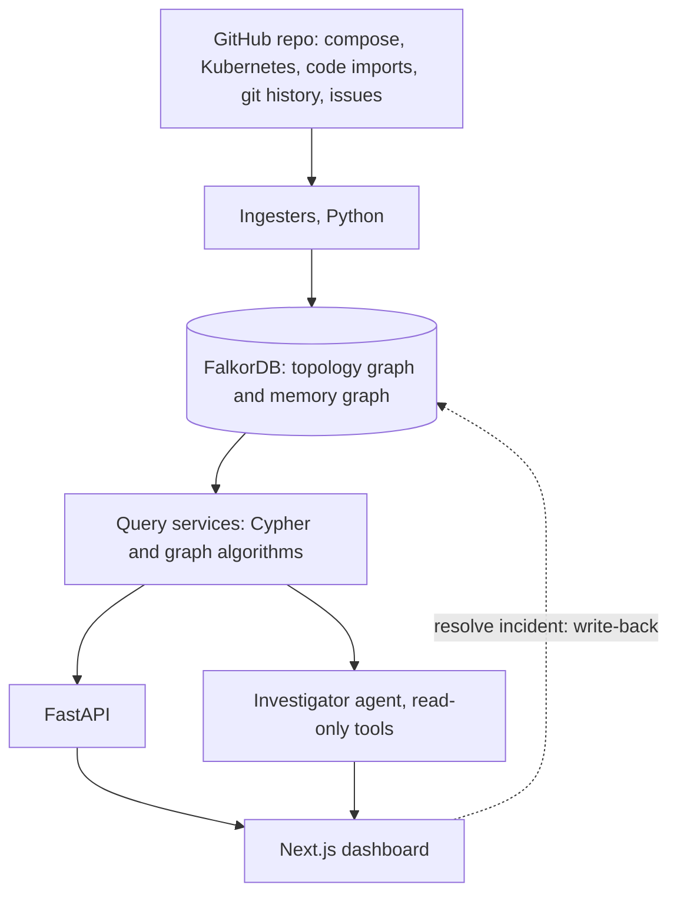

<p align="center">
  
</p>

<h1 align="center">Rhizo</h1>

<p align="center">
  Know what breaks before it breaks.<br/>
  Connect a GitHub repo, map how its services depend on each other, and see the blast radius of any failure, with the evidence.
</p>

<p align="center">
  [[Demo video: URL]] · [[Live deployment: URL, or delete this link]]
</p>

## The problem

When a service fails, someone has to answer three questions fast: what else breaks, who knows this system, and has this happened before. In most teams that knowledge lives in a few senior engineers' heads. Declared dependencies are incomplete, and the riskiest couplings (shared databases, files that always change together) are the ones nobody wrote down.

## What Rhizo does

Rhizo reads a public GitHub repository, builds a dependency graph in FalkorDB, and answers graph questions about it.

- **Connect any public GitHub repo.** Services are detected from docker-compose files, Kubernetes manifests, and a code import graph.
- **Blast radius.** If a service or resource fails, which services are affected, how many hops away, and how confident the path is.
- **Hidden dependencies.** Coupling nobody declared, found from shared resources and from git co-change.
- **Change check.** Risk of a diff, with the coupled files and likely reviewers.
- **Rankings.** The most critical services by graph centrality.
- **Incident memory.** Report and resolve incidents. Confirming or refuting a root cause updates the graph, so it improves with use.
- **Investigator.** Ask questions in plain language. Every answer shows the graph path and the query behind it.
- **Benchmark.** A held-out evaluation of hidden-dependency predictions per repo.

## Screenshots

| Landing | Graph and blast radius |
|---|---|
|  |  |

| Hidden dependencies | Investigator |
|---|---|
|  |  |

## Architecture



Each connected repo gets its own graphs, scoped to the signed-in user. FalkorDB is not optional: stop it and the API returns `503`, because blast radius, hidden dependencies and incident memory are all graph queries.

**Stack:** FalkorDB, Python 3.12 and FastAPI, Next.js, Docker Compose.

## Run it locally

**Requirements:** Docker with Compose, Node.js [[version]] or newer, and git.

```bash
git clone [[your repo URL]]
cd [[repo folder]]

# 1. Configuration
cp backend/.env.example backend/.env
cp frontend/.env.example frontend/.env.local

# 2. Generate one secret and put the SAME value in both files as AUTH_SECRET
openssl rand -base64 32
#   backend/.env          -> AUTH_SECRET=<value>
#   frontend/.env.local   -> AUTH_SECRET=<value>

# 3. Start FalkorDB and the API
docker compose up -d --build
docker compose ps                      # falkordb and api should be running

# 4. Start the frontend
cd frontend
npm install
npm run dev
```

Open **http://localhost:5173**, sign up with an email and password (no verification step), and wait for the built-in demo repo to reach **ready**.

| Service | URL |
|---|---|
| Dashboard | http://localhost:5173 |
| API and interactive docs | http://localhost:8000/docs |
| FalkorDB Browser (inspect the graph) | http://localhost:3000 |

### Configuration

| Variable | File | Purpose |
|---|---|---|
| `AUTH_SECRET` | backend and frontend | Signs and verifies login tokens. Must be identical in both files. |
| `GITHUB_TOKEN` | backend | Optional. A token with **no scopes** raises GitHub's rate limit for public repos. |
| `AGENT_MODE` | backend | `scripted` (default, no API key needed) or `llm`. |
| `ANTHROPIC_API_KEY`, `LLM_MODEL` | backend | Only for `llm` mode. |
| `NEXT_PUBLIC_API_BASE_URL` | frontend | API address, `http://localhost:8000` by default. |
| `FALKORDB_HOST_PORT` | root `.env` | Host port for FalkorDB. Set `6380` if your machine already uses `6379`. |

All variables are listed in the `.env.example` files. Never commit real values.

### Try it

1. The demo repo, Google's [Online Boutique](https://github.com/GoogleCloudPlatform/microservices-demo), is created automatically on first login.
2. Open **Graph**, select a service, and run **Simulate failure**.
3. Open **Hidden dependencies** and **Rankings** on the overview.
4. Go to **Repos**, paste any public GitHub URL, and wait for it to sync. Repos tried during development include `GoogleCloudPlatform/microservices-demo` and `mehdihadeli/food-delivery-microservices`.
5. Report an incident, resolve it, and watch the confirmed edge strengthen in the graph.
6. Remove the demo from **Repos** at any time, and bring it back with **Load demo repo**.

### Tests and checks

```bash
cd backend && pip install -e ".[dev]" && pytest && ruff check . && mypy rhizo
cd frontend && npm test && npx tsc --noEmit
```

### Troubleshooting

| Symptom | Fix |
|---|---|
| Every request returns `401` | `AUTH_SECRET` differs between the two files. Make them identical and restart both. |
| `port is already allocated` | Change `FALKORDB_HOST_PORT` in the root `.env`. |
| Repo sync fails with a rate-limit error | Add `GITHUB_TOKEN` to `backend/.env`, then `docker compose restart api`. |
| Changes to `backend/.env` do nothing | Run `docker compose up -d --build`. |

## Graph data model

**Topology graph**

| Node | Key properties |
|---|---|
| `Service` | `name`, `tier` (from centrality), `team`, `language` |
| `Resource` | `name` (for example a database or cache) |

| Relationship | Meaning | Properties |
|---|---|---|
| `(Service)-[:DEPENDS_ON]->(Service)` | A is hurt when B fails | `source`, `confidence`, `evidence`, `valid_from`, `valid_to`, `last_seen` |
| `(Service)-[:USES]->(Resource)` | A uses the resource | same as above |
| `(Service)-[:CO_CHANGES_WITH]-(Service)` | Changed together in git history | `jaccard`, `support`, `last_seen` |

**Memory graph**

| Node or relationship | Meaning |
|---|---|
| `Incident` | A reported or imported incident |
| `Engineer` | A committer or responder (pseudonymised by default, no emails stored) |
| `(Incident)-[:AFFECTED]->(Service)` | Services touched by the incident |
| `(Incident)-[:ROOT_CAUSE]->(Service or Resource)` | Confirmed root cause |
| `(Incident)-[:RESOLVED_BY]->(Engineer)` | Who resolved it |

`DEPENDS_ON` direction is the key convention: `A -> B` means **A is the victim when B fails**, so blast radius follows paths into the failing node. Edges carry provenance (`source`, `evidence`) and a time range, so the graph can be queried as of a past date and stale declared edges expire. [[Verify every label, relationship and property above against backend/rhizo/graph/schema.py and queries.py.]]

## Key Cypher queries

All queries live in `backend/rhizo/graph/queries.py`. Values are always passed as parameters.

**Blast radius of a service.** Follows `DEPENDS_ON` into the failing service, up to a bounded depth.

```cypher
MATCH p = (v:Service)-[:DEPENDS_ON*1..4]->(f:Service {name: $name})
WHERE all(x IN relationships(p) WHERE x.valid_to IS NULL AND x.confidence >= $min_conf)
RETURN v.name AS victim, length(p) AS hops,
       [n IN nodes(p) | n.name] AS path,
       reduce(c = 1.0, x IN relationships(p) | c * x.confidence) AS path_conf
```

**Blast radius of a resource.** If a shared resource fails, the first hop is `USES`, then `DEPENDS_ON`.

```cypher
MATCH p = (v:Service)-[:DEPENDS_ON*0..3]->(u:Service)-[:USES]->(r:Resource {name: $name})
WHERE all(x IN relationships(p) WHERE x.valid_to IS NULL AND x.confidence >= $min_conf)
RETURN v.name AS victim, length(p) AS hops, [n IN nodes(p) | n.name] AS path
```

**Hidden dependency through a shared resource.** Two services use the same resource, with no declared path in either direction. Directed checks matter: an undirected check hides nearly everything.

```cypher
MATCH (a:Service)-[:USES]->(r:Resource)<-[:USES]-(b:Service)
WHERE a.name < b.name
  AND NOT (a)-[:DEPENDS_ON*1..4]->(b)
  AND NOT (b)-[:DEPENDS_ON*1..4]->(a)
RETURN a.name, b.name, r.name
```

**Hidden dependency through co-change.** Services that change together in git history above a Jaccard threshold, again with no declared path.

```cypher
MATCH (a:Service)-[c:CO_CHANGES_WITH]-(b:Service)
WHERE a.name < b.name AND c.jaccard >= $min_jaccard
  AND NOT (a)-[:DEPENDS_ON*1..4]->(b)
  AND NOT (b)-[:DEPENDS_ON*1..4]->(a)
RETURN a.name, b.name, c.jaccard
```

**Write-back (incident resolution).** A confirmed edge is created or strengthened, and a refuted one is weakened.

```cypher
MATCH (a:Service {name: $from}), (b:Service {name: $to})
MERGE (a)-[r:DEPENDS_ON]->(b)
ON CREATE SET r.confidence = 0.60, r.source = 'confirmed', r.last_seen = $now
ON MATCH SET r.confidence = CASE WHEN r.confidence + 0.15 > 1.0 THEN 1.0 ELSE r.confidence + 0.15 END,
             r.valid_to = null, r.last_seen = $now

MATCH (a:Service {name: $from})-[r:DEPENDS_ON]->(b:Service {name: $to})
SET r.confidence = CASE WHEN r.confidence - 0.20 < 0.05 THEN 0.05 ELSE r.confidence - 0.20 END
```

[[Replace the five queries above with the exact versions from queries.py.]] Critical-service rankings use FalkorDB's PageRank where available and fall back to degree counts, and the API reports which algorithm ran.

## How accuracy is kept honest

- Path confidence is the product of edge confidences, and every edge shows its source and evidence.
- The Investigator is graph-driven: queries produce the facts, and it can only read the graph. [[In llm mode the model only phrases tool results, and a grounding check removes any service name that did not come from them. Delete this sentence if llm mode is not shipped.]]
- The benchmark hides the most recent 20% of commits, builds hidden dependencies from the rest, and measures how many later co-changes they predict, against a declared-edges-only baseline. Results are written by the run, never entered by hand, and a repo with too little history shows "insufficient history" instead of numbers.

## Limitations

- Public GitHub repositories only.
- Detection covers docker-compose, Kubernetes manifests, and Python and JS/TS imports. A repo with none of these shows "no structure detected".
- History is capped per sync (default [[3000]] commits). Repos with little history give weak co-change signals and benchmarks.
- Incidents come from closed bug-labelled issues, fix and revert commits, and the in-app report form.

## Project layout

```
backend/rhizo/   graph/ (queries, scoring, algorithms)  ingest/  services/  agent/  repos/  api/
frontend/        app/ (pages)  components/  lib/
docker-compose.yml
```

## Hackathon

Built for **WeMakeDevs Graph Hacks** with FalkorDB as the primary database.
**Tracks:** [[Agents That Act on Connected Data; Agent Memory and Coordination, confirm what you submitted]].
The UI scaffold was built before the event. All FalkorDB and backend work was done between 15 and 18 October 2026.

## AI assistance

An AI assistant (Anthropic's Claude) was used for code generation, debugging and tests; the problem, graph model and verification are the author's.

## Author

[[Your name and GitHub handle]]